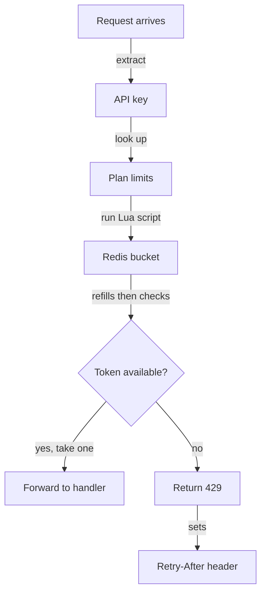

# Public REST API rate limiting

The public REST API will limit each API key with a token bucket stored in Redis. Limits come from the key's plan. A request over the limit gets HTTP 429 with a `Retry-After` header.

Two questions block implementation. Both are listed under "Open questions" and have no owner yet.

## Decisions

| Decision | Choice |
|---|---|
| Algorithm | Token bucket |
| Limit scope | One bucket per API key |
| State store | Redis |
| Limit source | Customer plan |
| Rejection response | HTTP 429 with `Retry-After` |

## Plan limits

| Plan | Limit | Bucket size | Refill rate |
|---|---|---|---|
| Free | 60 req/min | 60 tokens | 1 token/s |
| Pro | 600 req/min | 600 tokens | 10 tokens/s |

Bucket size equals the per-minute limit. A key can spend a full minute of requests in one burst. It then waits for the refill.

## Request flow

1. Read the API key from the request. If the key is missing or invalid, the auth layer rejects the request before the limiter runs.
2. Look up the plan for the key. Cache the plan in process memory for 60 seconds.
3. Run one Lua script in Redis against the key `ratelimit:{api_key}`. The script runs atomically, so concurrent requests cannot both take the last token.
4. Inside the script, read `tokens` and `last_refill_ms`. Add `elapsed_seconds × refill_rate` tokens, capped at the bucket size.
5. If at least one token remains, subtract one and save the state. Forward the request.
6. If no token remains, save the refilled state. Return 429.
7. Set a TTL on the Redis key equal to the time to refill an empty bucket. Idle keys then expire.

## Retry-After value

`Retry-After` is the number of whole seconds until one token is available. The script computes `ceil((1 - tokens) / refill_rate)`. A free-plan key with an empty bucket gets `Retry-After: 1`.

## Open questions

| Question | Options | Owner |
|---|---|---|
| Behaviour when Redis is down | Allow all requests, or reject all | Unassigned |
| Extra headers on every response | Add `X-RateLimit-Limit` and `X-RateLimit-Remaining`, or none | Unassigned |
