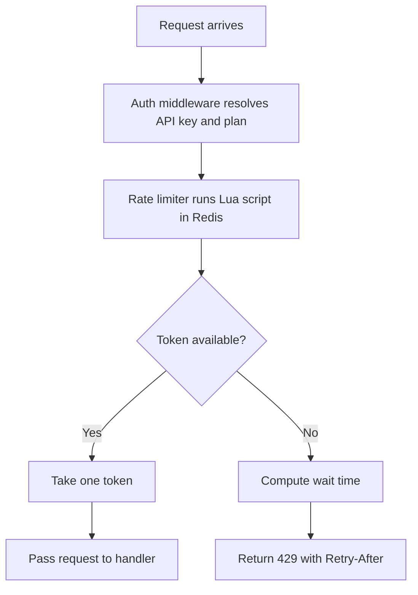

# Public REST API rate limiting

We will limit each API key with a token bucket. Bucket state lives in Redis. Limits come from the customer's plan. A request over the limit gets HTTP 429 with a `Retry-After` header.

## Decisions

| Decision | Choice |
|---|---|
| Algorithm | Token bucket |
| Scope | One bucket per API key |
| State store | Redis |
| Limit source | Customer plan |
| Over-limit response | HTTP 429 |
| Retry hint | `Retry-After` header in seconds |

## Limits per plan

Bucket capacity equals the per-minute limit. A full bucket allows a burst of one minute's worth of requests.

| Plan | Limit | Capacity | Refill rate |
|---|---|---|---|
| Free | 60 req/min | 60 tokens | 1 token/s |
| Pro | 600 req/min | 600 tokens | 10 tokens/s |

Plan limits live in config. Adding a plan needs no code change.

## Request flow

1. The auth middleware resolves the API key and its plan.
2. The rate limiter calls one Lua script in Redis. The script runs atomically.
3. The script reads the bucket. It adds tokens for the time since the last refill. It caps the total at capacity.
4. If at least one token remains, the script takes it. The request goes to the handler.
5. If no token remains, the script returns the wait time. The API returns 429.

## Redis state

Each API key has one hash under the key `ratelimit:{api_key}`.

| Field | Meaning |
|---|---|
| `tokens` | Tokens left as a float |
| `updated_at` | Time of last refill in milliseconds |

The script sets a TTL equal to the time to refill a full bucket. Idle keys expire. An expired key reads as a full bucket.

The script uses Redis server time. App server clocks do not affect the result.

## Retry-After

`Retry-After = ceil((1 - tokens) / refill_rate)`

A free-plan key with 0.2 tokens waits `ceil(0.8 / 1)` = 1 second.

## Open questions

- Should the API fail open or fail closed when Redis is down?
- Should every response carry `X-RateLimit-Limit` and `X-RateLimit-Remaining` headers?
- Do any endpoints need a higher token cost than one?
