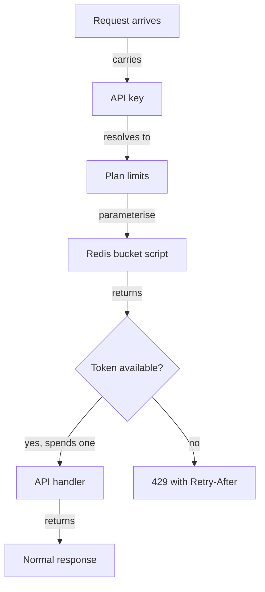

# Rate limiting for the public REST API

Every request to the public REST API spends one token from a bucket owned by its API key. The buckets live in Redis. A request that finds the bucket empty gets HTTP 429 with a Retry-After header. Three open items block the build. None has an owner yet.

## Decisions

| Decision | Choice |
|---|---|
| Algorithm | Token bucket |
| Bucket scope | One per API key |
| State store | Redis |
| Limit source | Customer plan |
| Over-limit response | HTTP 429 |
| Retry hint | Retry-After header |

## Limits by plan

A bucket holds one minute of tokens. That allows a burst of a full minute's quota after a quiet period.

| Plan | Requests per minute | Bucket capacity | Refill rate |
|---|---|---|---|
| Free | 60 | 60 tokens | 1 token per second |
| Pro | 600 | 600 tokens | 10 tokens per second |

Plan limits live in configuration. A new plan needs a config entry and no code change.

## Request flow

1. Authenticate the request and read its API key.
2. Look up the plan for that key. Cache the result in process for 60 seconds.
3. Run the bucket script in Redis with the key, capacity and refill rate.
4. If the script returns a token, pass the request to the handler.
5. If the script returns no token, return 429 with the wait time from the script.

The limiter runs after authentication. An unauthenticated request has no key and never reaches the limiter.

## Redis state

Each API key has one Redis hash at `ratelimit:{api_key}`.

| Field | Holds |
|---|---|
| `tokens` | Tokens left, as a float |
| `updated_at` | Time of last refill, in milliseconds |

A Lua script updates the bucket in one atomic step. It reads the state, adds refilled tokens and spends one. Two API servers serving the same key at the same moment cannot both spend the last token.

The script reads the clock with the Redis `TIME` command. This removes clock skew between API servers.

The script sets a time to live (TTL) on the hash equal to one full refill period. An idle key's bucket expires and comes back full on its next request. Redis memory stays bound to active keys.

## Retry-After value

The script computes the wait for the next whole token.

`retry_after_seconds = ceil((1 - tokens) / refill_rate_per_second)`

A free key with 0.2 tokens left gets `Retry-After: 1`. The header carries whole seconds, as RFC 9110 (the HTTP semantics standard) requires.

## Open items

| Item | Proposal | Owner |
|---|---|---|
| Behaviour when Redis is down | Allow the request and log it | Unassigned |
| Rate limit headers on success | Send limit and remaining counts | Unassigned |
| Plan change mid-period | Apply new capacity on next request | Unassigned |
