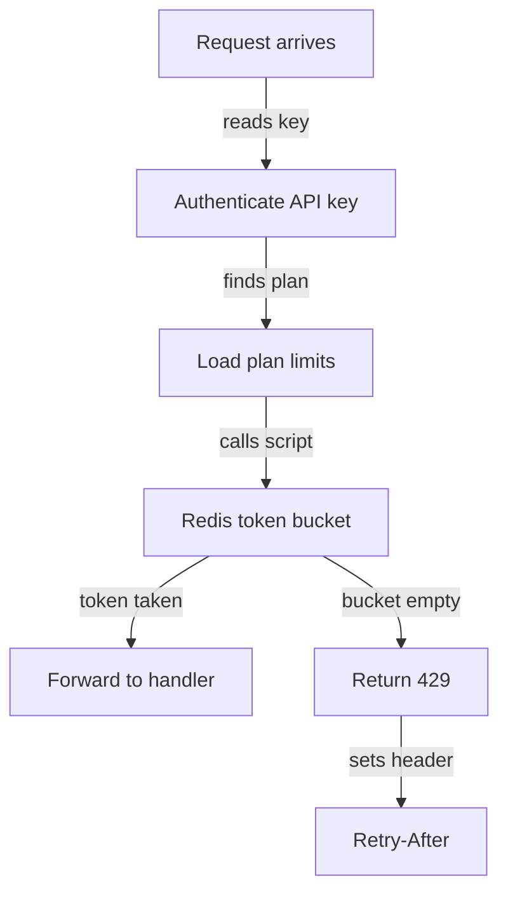

# Public REST API rate limiting design

The public API will limit each API key with a token bucket. Bucket state lives in Redis. Each plan sets its own limit. A request over the limit gets HTTP 429 with a `Retry-After` header.

## Decisions

| Area | Decision |
|---|---|
| Algorithm | Token bucket |
| Scope | One bucket per API key |
| State store | Redis |
| Free plan | 60 requests per minute |
| Pro plan | 600 requests per minute |
| Over-limit response | HTTP 429 |
| Wait hint | `Retry-After` header in seconds |

## Plan limits

Each plan maps to a bucket capacity and a refill rate. Capacity equals the per-minute limit. A full bucket allows a burst up to one minute of quota.

| Plan | Capacity | Refill rate |
|---|---|---|
| Free | 60 tokens | 1 token per second |
| Pro | 600 tokens | 10 tokens per second |

Limits live in plan configuration. A plan change takes effect on the next request without a deploy.

## Request flow

1. Authenticate the API key. If the key is missing or invalid, return 401 before the limiter runs.
2. Look up the key's plan and read its capacity and refill rate.
3. Call one Lua script in Redis. Pass it the key, plan limits and current time.
4. The script refills the bucket for the time elapsed since the last request. It caps the count at capacity.
5. If the bucket holds at least one token, the script takes one and returns "allowed".
6. If the bucket is empty, the script returns "denied" and the seconds until the next token.
7. If allowed, forward the request to the handler.
8. If denied, return 429. Set `Retry-After` to the seconds from step 6, rounded up.

## Redis state

| Field | Holds |
|---|---|
| Key name | `ratelimit:{api_key_id}` |
| `tokens` | Current token count |
| `updated_at` | Time of last refill in milliseconds |
| TTL | Time to refill a full bucket |

The Lua script runs the read, refill and write as one atomic step. Two API servers cannot spend the same token.

The TTL removes buckets for idle keys. An expired bucket starts full.

## Response headers

Every response carries the current state. Clients can slow down before they hit 429.

| Header | Value |
|---|---|
| `Retry-After` | Seconds until one token is free. 429 only. |
| `RateLimit-Limit` | Plan capacity |
| `RateLimit-Remaining` | Tokens left after this request |

## Failure handling

If Redis is unreachable, the limiter allows the request and logs the error. An outage in Redis must not take down the API. An alert fires when the error rate passes a threshold.

## Open items

| Item | Owner |
|---|---|
| Fail-open alert threshold | Platform team |
| Limits for enterprise plans | Product |
| Per-endpoint cost weights | Not in scope for this version |
