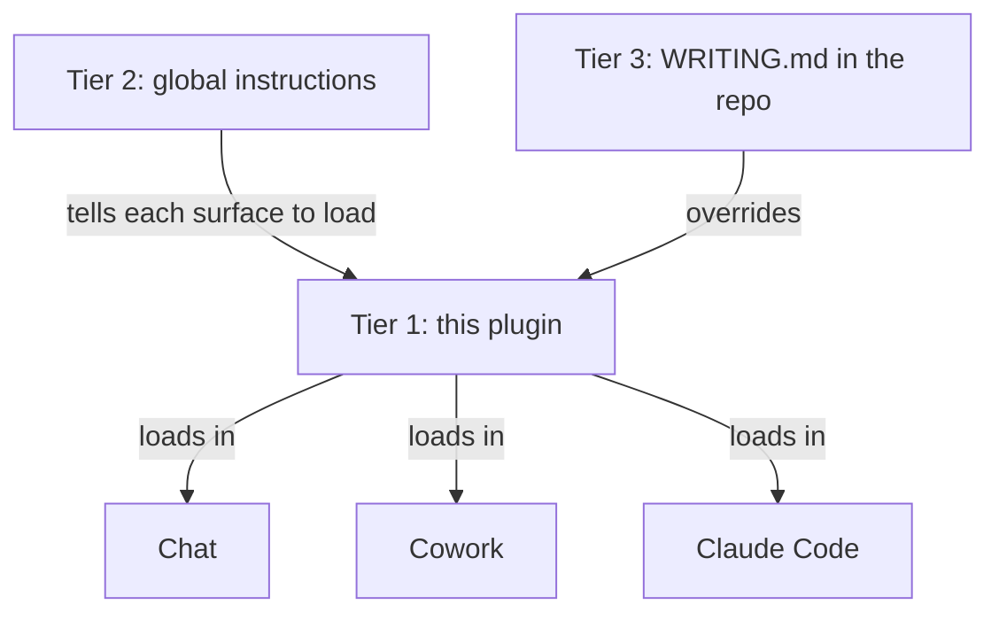

# writing

The house writing standard and working style, as one plugin for every surface. Project tweaks live in a `WRITING.md` at the repo root.

## The tiers



| Tier | Where it lives | What it holds |
|---|---|---|
| 1 plugin | this repo, installed from claude.ai | the full rules, the card, the linter, the hooks |
| 2 global instruction | Cowork settings, chat preferences, `~/.claude/CLAUDE.md` | two lines that say load the plugin |
| 3 project | `WRITING.md` at the repo root | audience, project terms, a rule added or relaxed, a project linter |

## What the plugin contains

| Component | Name | Job |
|---|---|---|
| Skill | `writing-standard` | the prose rules and the check before you send |
| Skill | `working-style` | session behaviour: answer first, no narration, do the work, hold the objective |
| Skill | `improve-readability` | review one file, report findings, never edit |
| Skill | `review-prose` | review a diff, a ref or a PR, report findings, never edit |
| Command | `/writing:lint <file>` | run the linter on one file and print its output |
| Card | `standard/card.md` | the rules that hold before any skill loads |
| Script | `scripts/writing_lint.py` | the mechanical rules, exit 0 always |
| Hook | SessionStart | prints the card into the session context |
| Hook | PostToolUse on Write and Edit | lints every Markdown file an agent writes and feeds findings back |

The hooks run in Claude Code and in Cowork sessions on your computer. Chat has no hooks, so chat relies on the skills alone.

## Tier 2: the global instruction

Paste this block into Cowork global instructions and into claude.ai preferences. Keep it in `~/.claude/CLAUDE.md` too. The fallback card ships with the plugin and the SessionStart hook loads it, so nothing else is pasted anywhere.

```markdown
Load the writing:working-style and writing:writing-standard skills before the first reply in every session and follow them.

If a WRITING.md exists in the working folder, read it too.
```

## Tier 3: WRITING.md

A plain Markdown file at the repo root. The skills read it before writing and it wins on conflict. Keep it short. A template:

```markdown
# Writing overrides for this repo

Audience: <who reads the output of this repo>.
Terms: <project IDs and their plain names, or a link to a glossary>.
Added rules: <one per line, or none>.
Relaxed rules: <one per line, or none>.
Project linter: <command, or none>.
```

## Updating the rules

Edit the skills here and bump `version` in `.claude-plugin/plugin.json`. Commit and push. Every surface picks up the new version on its next sync. Run the linter on the skill files before you push.
